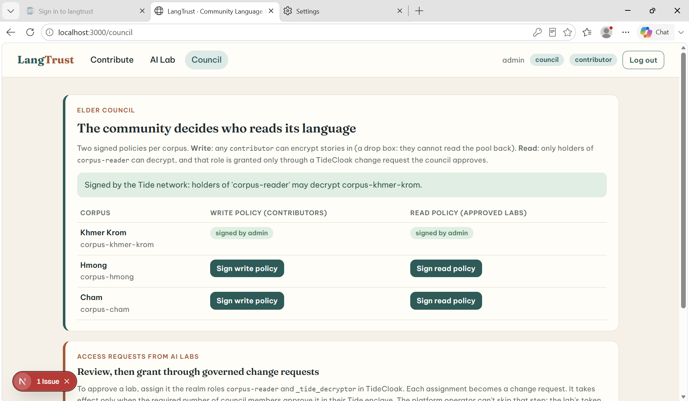
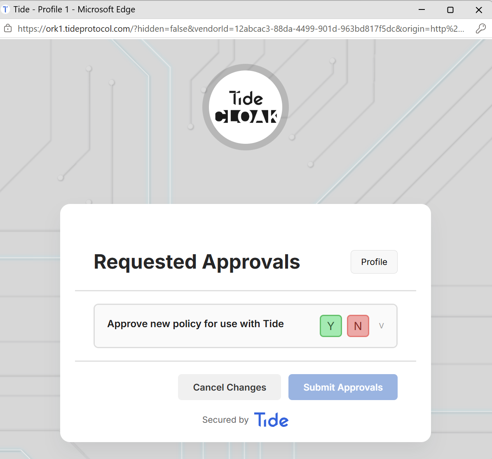
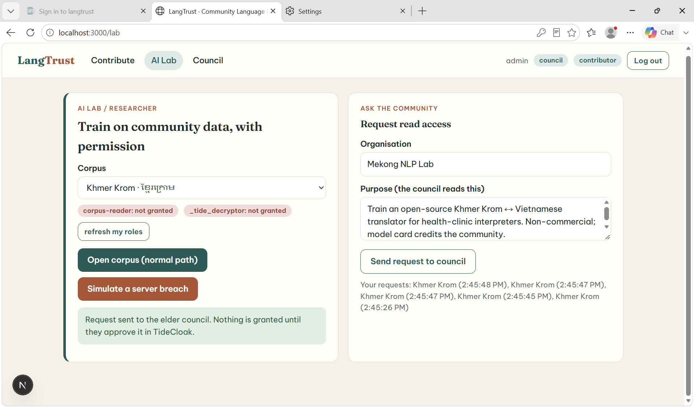
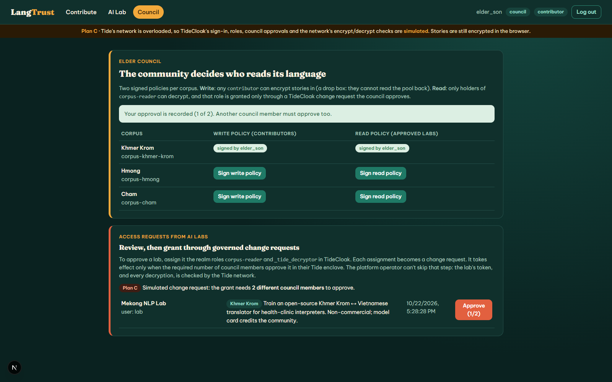
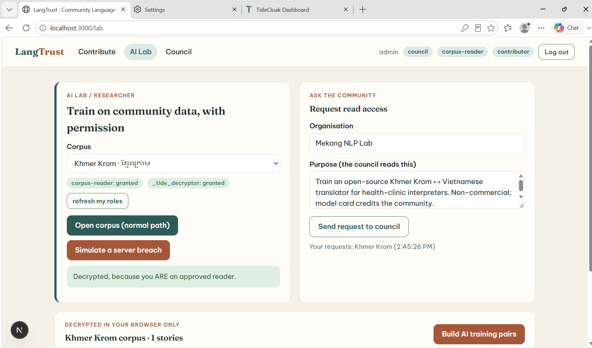
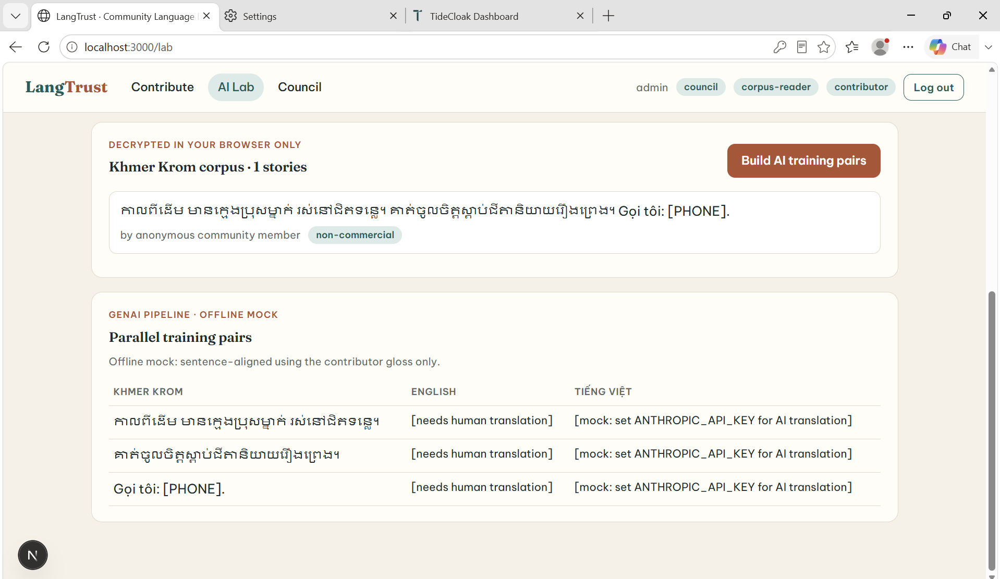

[](https://tide.org/tidecloak?utm_source=github&utm_medium=readme&utm_campaign=unlocked)

## Project overview

_LangTrust is a community-governed data trust where minority-language speakers donate stories to train translation AI, and only labs their elder council approves can ever decrypt them._

Built with [TideCloak](https://tide.org/tidecloak?utm_source=github&utm_medium=readme&utm_campaign=unlocked).

### 1. Vision & originality

A language data trust for Vietnam's ethnic-minority languages (Khmer Krom, Hmong, Cham). Communities pool oral stories into a corpus AI can learn from, but the community, not the platform, decides who reads it.

### 2. Trust constraint insight

Low-resource languages stay low-resource because communities have been burned: recordings scraped, data reused without consent, culture turned into someone else's product. Donating today means trusting the platform, its admins, its cloud and every future AI partner forever. So people don't, and translation AI never reaches the clinics, courts and schools that need it.

### 3. Value & impact

A Khmer Krom grandmother records a folk tale. A university lab building a clinic-interpreter model asks for access and states its purpose. The village council approves. The lab trains on consented data, and speakers can withdraw. Culture powers AI without being given away.

### 4. Why TideCloak matters

- Stories are **encrypted in the contributor's browser** under a Tide `RelationshipAttestation:1` policy; the server holds only ciphertext.
- The **council (Tide realm admins) signs** each corpus's write and read policies in the Tide enclave.
- Read roles are granted only through **quorum-governed TideCloak change requests**.
- **The Tide network checks every decryption**: even a leaked database plus policy decrypts nothing.

With ordinary login and backend permissions, whoever runs the backend could read everything.

### 5. Prototype & storytelling

Watch for three moments: a story is encrypted and the operator sees only ciphertext. **"Simulate a server breach"** is refused by 20 Tide nodes. The council approves a change request, then the lab decrypts in-browser and GenAI builds training pairs.

## Screenshots

| | |
|---|---|
|  Council signs the write and read policies (Tide network signature) |  Approval happens in the Tide enclave, not in our app |
|  Lab without approval: breach simulation refused by the network |  Granting `corpus-reader` is a change request needing council approval |
|  After approval: the lab decrypts in its own browser |  GenAI pipeline turns the decrypted, consented stories into parallel training pairs |

## What we verified end to end (local TideCloak + live Tide network, 22 Oct 2026)

| Check | Result |
|---|---|
| Council signs `RelationshipAttestation:1` write and read policies for `corpus-khmer-krom` | Signed by the network, stored, then validated server-side (contract, subject, record, roles) |
| Contributor encrypts a story (phone number stripped on-device first) | Server stored ciphertext only |
| Contributor tries to read the corpus back with the write-only policy | Refused by all 20 ORKs: `_tide_decryptor not found in list of roles` |
| Breach simulation: the server leaks the ciphertext **and** the signed read policy to a lab without approval | Refused by the ORKs: `'_tide_decryptor' role not found for this decryption request` |
| Grant `corpus-reader` and then `_tide_decryptor` | Each one is a `GRANT_ROLES` change request, `0/1` until the council approves it in the Tide enclave |
| Approved lab opens the corpus | Decrypted in the browser |

## Setup

Requirements: Docker, Node.js 20.9+, and `curl` + `jq`. On Windows you also need Git Bash, plus `winget install jqlang.jq`.

```bash
# 1. TideCloak dev server
docker run --name mytidecloak -d -p 8080:8080 \
  -e KC_BOOTSTRAP_ADMIN_USERNAME=admin -e KC_BOOTSTRAP_ADMIN_PASSWORD=password \
  tideorg/tidecloak-dev:latest

# 2. Install, then provision the realm: roles, IGA, licence and the first council admin.
#    It prints an "ACTION REQUIRED" link: open it and link or create your Tide account.
npm install
npm run init          # Windows: npm run init:win

# 3. Run
npm run dev           # http://localhost:3000
```

Optional: put `ANTHROPIC_API_KEY=...` in `.env.local` and the lab's training-pair builder uses Claude. Without a key it runs an offline mock.

### Browser notes (important)

Tide's sign-in page (`https://ork*.tideprotocol.com`) must call your **local** TideCloak (`http://localhost:8080`). Chrome and Edge block public-to-localhost requests ("Local Network Access"), which shows up as *"Error creating user account. Network request failed"*. Pick one of these:
- Allow **local network access** for `ork1.tideprotocol.com` when the browser asks, **or**
- Use the throwaway Edge profile scripts: `init\enrol-edge.ps1` (mints a fresh enrolment link with `init/new-link.sh`) and `init\open-app-edge.ps1` (opens the app).

Also allow **pop-ups** for `http://localhost:3000` and `http://localhost:8080`. The Tide enclave approval opens as a pop-up.

### Demo walkthrough

1. **Council** (the enrolled admin) → *Council* → **Sign write policy** and **Sign read policy** for Khmer Krom (approve in the Tide window).
2. **Contributor** → *Contribute* → use the sample story → **Encrypt & contribute**. *Try to read it back* is refused, because the corpus is a drop box.
3. **Lab** → *AI Lab* → **Simulate a server breach** is refused → **Send request to council**.
4. **Council** → TideCloak dashboard (`/realms/langtrust/tide-console/`) → Users → the lab user → Role mapping → assign `corpus-reader` and `_tide_decryptor` → *QEA Approvals* → **Authorize** each request in the Tide window.
5. **Lab** → *refresh my roles* → **Open corpus** decrypts → **Build AI training pairs**.

For the prototype, one Tide account can play every role. In production, each role is a different person, and the council threshold is raised so that no single admin can approve alone.

### How TideCloak is used (code map)

| What | Where |
|---|---|
| Realm roles `contributor`, `corpus-reader`, `_tide_encryptor`, `_tide_decryptor` | `init/realm.json` |
| Provider, login, token refresh | `app/layout.tsx`, `app/shell.tsx` |
| Server-side JWT verification on every API route | `lib/auth.ts` (`verifyTideCloakToken`) |
| Policy signing in the enclave, then encrypt and decrypt | `lib/tide/relationship.ts` (from Tide's agent pack), `app/council`, `app/contribute`, `app/lab` |
| Policies validated before storage | `app/api/policies/route.ts` |
| Ciphertext-only storage and audit ledger | `lib/store.ts` (`data/db.json`, gitignored) |
| Breach simulation (demo only, `BREACH_SIM=off` disables it) | `app/api/breach-sim/route.ts` |

### Honest limits

- `_tide_encryptor` is in the default roles so any community member can write to the drop box. Read access is the governed boundary.
- Revocation: contributors can withdraw their stories, and removing `corpus-reader` stops future decryption at the next sign-in. Plaintext a lab already decrypted can't be recalled.
- All data is synthetic. The sample sentences are illustrative and haven't been checked by native speakers.
